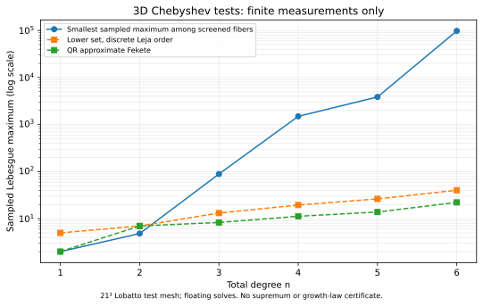

# Unisolvent lattice subsets beyond checkerboards — development report

**3D candidates survive the counting and exact-rank screens. No infinite-degree 3D family with an axis-factorized criterion or convincing Chebyshev stability emerges from this bounded campaign.** These conclusions have different scopes: correct counts hold for an infinite cyclic6 family; exact nonzero witnesses establish generic feasibility only for listed finite-degree patterns once the written reduction/checks are applied; finite Lebesgue samples do not prove an asymptotic obstruction. No publication-level novelty is claimed.

This is stacked on charter PR #2 and changes no charter text. Original base eb7bdcdf3a587dd49ea9d692b1d27c7af053fe64, audited base update3bd9d4e and administrative response317a265 merged without rebasing; the parent is now Stage PR. Rules read e949ef06895acd5463cdf8df7e0e5f795218f70f. User's explicit Step0 and provisional-ID instructions govern this campaign. Exact ledger: [shared allocations](../padua-batch-20261031/ALLOCATIONS.md).

## Ranked development briefs

| Rank / candidate | What survives | (a) Periodic | (b) Axis factor / structural criterion | (c) Chebyshev stability | Disposition / next decisive step |
|---|---|---|---|---|---|
| 1: parity-adapted2D adjacent-mod4 family | Correct cardinality at every degree: phase0for odd n, phase1for even n; complete row-root and Gram reductions | Yes, adjacent pair of residue classes mod4 | Arbitrary-field row-moment iff and explicit Chebyshev block-Gram iff are PROVED; all-degree strict contraction remains OPEN; pure axis product already fails at n2/n3 | Finite sample71.507at n31,45.853at n32; log² target OPEN | Retain strongest development lead. Prove strict contraction or identify a verified known family, then seek a localized kernel estimate rather than more rank samples |
| 2: isolated degree-two3D fibre a=(3,1,2) mod6 | Exact ten-node axis-factorized determinant, arbitrary fields | Yes | Two explicit axis additive-gap conditions; all strictly monotone real axes work | Lobatto sampled maximum5.848at n2 only | Genuine finite(a,b) structural survivor, no novelty claim. Naive continuation fails the recorded count/rank scopes; no unbounded-degree theorem |
| 3: diagonal3D cyclic6 fibres on lengths(n+1,n+2,n+3) | Infinite exact-cardinality count with full residue correction; finite generic-rank witnesses | Yes | No infinite-family factorization established; tested higher-degree survivor determinants have mixed-axis rectangle obstructions | Unfavorable finite measurements; n6 a111 consecutive fibre sampled maximum about128123 | Retain counting/feasibility lead, not an accepted3D Padua analogue. Resume only with a concrete new structural or stable pattern |
| 4: explicit small3D mixed-axis determinant | Degree-one periodic example with complete mixed criterion | Yes | Exact criterion refutes independent axis predicates for this example | Degree-one stability implies no growing-degree family | Retain scoped obstruction/teaching case, no novelty claim |
| 5: remaining bounded instances and omitted classes | Every failed parameter and deferred scope retained | As stated per row | Some deficiencies have universal certificates; nine sampled deficiency cases remain unexplained | Fixed Lobatto screen gives no higher-degree stability opening | No general classification. Larger moduli, other offsets, zeros, other unions and boundary corrections remain outside the finite catalogue |

## What was actually screened

C0 uses primitive characters with every coefficient nonzero, k2..6, n1..6 and sorted axis lengths in{n+1,n+2,n+3}. Shorter axes have a separate universal annihilator and are excluded from the potentially unisolvent catalogue. Zero coefficients, arbitrary unions and boundary corrections are explicitly deferred; the catalogue is not a classification of every periodic set.

All77616 raw parameter tuples are represented by5061 canonical count trials, with explicit orbit equivalences. Of these,4610 fail exact cardinality and451 match:39 in2D,412 in3D. The row-inheritance schema preserves each tried tuple's hypotheses, closest predecessor, kill test, exact count, disposition and aliases. It avoids treating thousands of parameter instances as unrelated new mechanisms.

C3 tests all412 3D count survivors, mapping identical/reversed point sets to364 representatives. Each receives two distinct-node draws at each of1009,1013,1019:2184 exact modular matrices. The seeded finite ranks stay MEASURED; the separate determinant-polynomial lifting/degree statement supplies any stronger conclusion only when its recorded exact witness and independent checks are present.

| n | Count-surviving 3D patterns | Distinct representatives | Full rank at least once | Deficient in every sampled matrix |
|---|---:|---:|---:|---:|
| 1 |119|77|50|27|
| 2 |68|62|19|43|
| 3 |78|78|32|46|
| 4 |45|45|18|27|
| 5 |56|56|16|40|
| 6 |46|46|7|39|

There are142 representative survivors and222 always-deficient representatives in this finite screen.127 of the latter have explicit coordinate-layer covers of total degree<=n. A further86 have projected-count/layer-removal certificates, for213 certified instances under the separate written annihilator reductions and independently checked finite certificates. The9 remaining failures are not promoted to universal singularity. Exact axis-rectangle counterexamples also refute a pure axis rational-product determinant in114 of142 finite-degree survivor instances; they do not rule out other structural criteria. Small integer witnesses and normalized symbolic determinants are retained, including an accidentally singular integer draw rather than hiding it.

## Stability comparison and limits

C3 uses a21³ Chebyshev–Lobatto test mesh and floating solves in a total-degree tensor-Chebyshev basis. Numerical rank, condition number and nodal cardinality residuals are retained. Numerically singular cases do not receive a finite Lebesgue value. The reference approximate-Fekete set is a fresh QR extraction from a tensor Lobatto mesh, not a reproduction of a named paper's curve-based set. Lower-set references include both natural and discrete-Leja axis ordering; the latter is materially stronger in this experiment.

| n | Smallest recorded sampled maximum among screened 3D survivors | Lower set, discrete Leja order | QR approximate Fekete |
|---|---:|---:|---:|
|1|2.00|5.00|2.00|
|2|4.84|7.00|7.00|
|3|88.99|13.17|8.32|
|4|1497.77|19.50|11.24|
|5|3863.70|26.34|13.86|
|6|97819.06|40.28|22.19|

All values in this table/figure are **MEASURED**. They are sampled maxima, not certified continuous suprema; neither a universal lower bound nor an asymptotic growth law is inferred. The finite comparison gives no stability-driven continuation for the screened high-degree Lobatto patterns. It does not rule out other labels, other moduli, different coset unions, or boundary-corrected families.

## The continuing2D lead and its exact proof gap

For n>=1 use x_i=cos(pi*i/n),y_j=cos(pi*j/(n+1)), and select i+jmod4in{0,1}at odd degree or{1,2}at even degree. The complete phase-count formula proves exactly binomial(n+2,2)nodes at every degree. This schedule is an antipodal transversal; the original unshifted n≡2mod4singularity is preserved as a separate negative and does not reject the shifted family.

The arbitrary-field row-root criterion replaces pointwise evaluation by a square coefficient/moment matrix of size n(n+1)/2. At Chebyshev nodes, a separately proved normalization gives G=1/2[[I,A_n],[A_n^T,I]], explicit quarter-character moment entries, and exact equivalence between unisolvence and ||A_n||<1. This supporting theorem does not establish strictness for every n. Its coarse conditional Lebesgue bound retains a sqrtNfactor, so it does not establish any polylogarithmic growth law.

| Degree / phase | Mod4 sampled maximum | Standard Padua sample | Lower set, discrete Leja sample |
|---|---:|---:|---:|
|7 /0|24.277|5.836|16.101|
|14 /1|25.942|7.954|31.646|
|15 /0|43.052|8.187|37.795|
|30 /1|44.001|10.736|89.899|
|31 /0|71.507|10.867|99.349|
|32 /1|45.853|10.994|149.787|

These are **MEASURED adaptive sample maxima**, with recorded conditioning and inverse residuals, not true suprema or asymptotic fits. The additional measured block gap at n64is0.0344938473. Across C1,84exact modular draws,57adaptive comparison rows and17Gram diagnostics are retained. The universal unisolvence and log² targets remain OPEN. Ten initial conceptual rounds plus a written two-round extension filled the previously omitted n≡0mod4phase; the12-round stop preserves a precise new-proof resumption condition.

## Literature separation and retained gaps

The [Step0 baseline](../../literature/lattice-unisolvence/baseline.md) was recorded before exploration. The later [search log](../../literature/lattice-unisolvence/search-log.md), [comparison](../../literature/lattice-unisolvence/comparison.md) and [candidate-specific screen](../../literature/lattice-unisolvence/candidate-screen.md) retain67 queries and22 coverage-qualified source records. Twenty records inspect primary-paper excerpts, one primary slides and one publisher abstract; no complete-reading claim is made. The original Biermann/Chung–Yao/Gasca–Maeztu historical texts and Cools–Poppe detailed fulltext have named gaps.

Lower-set interpolation already supplies arbitrary distinct-node unisolvence. Natural lattices are a different construction, not an interchangeable attribution. Known Lissajous–Chebyshev interpolation uses its source spectral space; it is not silently equated with the full total-degree simplex in3D. Bos–De Marchi–Vianello's specific curve limitation is not a general no-go theorem. Li–Sun–Xu's cubature conjecture does not constrain this interpolation-only campaign. The inspected determinant predecessors make axis separation an established mechanism. Floater's interlaced-grid journal coverage remains pending-reference. No exact matching cyclic6/mod4 theorem was identified within the documented search, which leaves novelty UNVERIFIED.

## Evidence, stop conditions and handoff

Each direction freezes questions before runs and retains rounds/corrections. C0 closes after answering its bounded catalogue and infinite-count questions. C3 continues beyond rank to annihilator, determinant and stability tests; its broad infinite-degree structural/stability target remains OPEN. C1 is launched only after C0 closes; shifted phases and odd-degree subsequences are retained when they escape the initial symmetry obstruction. At most two substantive directions are active at a time, no ultra assignment, and no exhausted direction is described as a universal negative.

The separate Astra reconstruction covers every retained candidate and consequential computation; its exact coverage, findings and dispositions are linked in the audit handoff. Required Claude audit is distinct and remains PENDING until performed. Scientific statements keep provisional IDs at AC's request. Final global allocations, other-member acknowledgement, Windows cold-storage receipt and integration reconciliation remain visible obligations, not inferred approvals. See [audit handoff](AUDIT_HANDOFF.md) for exact commands, target hashes and remaining work.
