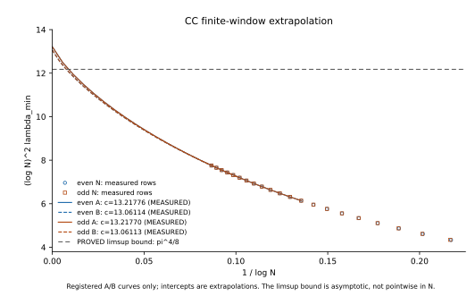

# Sharp MZ constants through explicit endpoint and corner operators

Source/rules read at2143ad622fa98faf8fe7d5cb8ed2bb7e0062f861; base main76ba4214b100c86a44941f5e9a662ce9ce48efb8. Scope and chronology are in [LOG](LOG.md); exact prospective tests in [gates](gates.md). Mathematical development and the bounded numerical campaign are complete under the directions' scopes. Required substantive Claude audit is pending; supplementary reports below are separate checks.

## Findings by target

| Target | Exact analytic conclusion | Numerical evidence and remaining scope |
|---|---|---|
| PD-T020, sharp CC lower constant | PROVED local limsup(logN)^2 lambda_min<=pi^4/8, through all integers N and each parity; exact Volterra model norm2/pi | Full limit, sharpness and actual minimum parity agreement OPEN. K1 final-window intercepts about13.06114 are fitted measurements, not an exact asymptotic constant. K2 operationally kills the equality-model route; no fitted revision. |
| PD-T027, sharp CC upper limit/uniform gap | PROVED local all-N lambda_max<=5/3; common-parity limitLambda_edge is the exact registered endpoint norm,1<=Lambda_edge<=3/2; computable finite errorepsilon_N=U_N−L_N->0 brackets both finite and limiting values | FiniteJ512 proxy1.0044369188646673; upper-spectrum fitted limits about1.0044369723. K3 operational measured comparison passes. Certified decimal evaluation and a practical elementary rate OPEN; no finite certificate solve was run. |
| PD-T381, signed Padua logarithmic constants | PROVED local common even/odd limits equal inf/sup spectrum of one explicit compact Bessel corner operatorB; normtail120/K and explicit finite-m error; constants strictly negative/positive | FiniteK128 proxies about−0.1336,+0.0456 remain heuristic. No certified decimal interval or closed scalar expression. Larger finite spectra/gates below are measurements and do not establish these proofs. |

The exact operator characterizations and computable finite approximation errors determine constants independently of the original large finite spectral problems. They are not claims of elementary closed formulas. Shared registry statuses/IDs remain unchanged in this draft; the audit must assess the precise original-target mapping before preparation.

## CC lower direction: valid inequality, stopped equality route

[Volterra model norm](theory/S1-volterra-model.md) and [one-sided CC theorem](theory/S1-sharp-one-sided.md) are separate proved records. Smooth compact logarithmic envelopes are assigned to actual CC nodes with exact opposite reflection, so the degreeN constraint cancels on both parities. Their discrete mass is2pi²logN times the envelope norm, while continuous mass has the corresponding4(logN)^3 primitive lower limit. Signed pole pairing, uniform cotangent error and oscillatory averaging are proved explicitly; density givespi^4/8.

[Independent reconstruction](independent-checks-S1-S3.md) accepts the full finite-to-trial proof. It was completed before S1 received the K2 result. K1's registered two disjoint fit windows have intercept drift1.185%, within2%; their final intercept differs frompi^4/8 by7.268%, exceeding K2's5% cutoff. S1 accepts that operational stop and declines arbitrary numerical retuning. This gate does not refute the one-sided theorem or prove a different true constant. The missing reverse bound/limit is not labeled PARTIAL merely because a supporting inequality is proved. [Attempt and stop record](attempts/S1.md).

The curves reuse the registered coefficients; no new fit is performed. The horizontal bound is asymptotic, not a pointwise bound for each finiteN.

## CC upper direction: signs, density and a finite certificate

The exact completion R=M−H+K has positive reflectedH and a bounded transitionK. A parity-sensitive row estimate and the independently proved PD-T015 mass floor give the [uniform5/3 bound](theory/S2-uniform-upper.md), bypassing the failed sign-erased gap intermediary. Combining it with the existing lower-eigenvalue order gives the [eta-deficit theorem](theory/S2-eta-deficit.md).

The [registered endpoint model](theory/S2-endpoint-model.md) uses exact finite cosine-cardinal combinations. [Fixed-J estimates](theory/S2-fixed-trial-limit.md) have explicit continuous/discrete form errors. The [full qualitative convergence proof](theory/S2-qualitative-limit.md) adds two weak endpoint profiles, compact transitionK, positive-core Fatou control and density in the actual critical Fourier-energy domain; pointwise entries alone are not used to infer a spectral limit.

[Finite certificates](theory/S2-finite-certificate.md) then replace the qualitative residual by finite physical/Laplace windows and a midpoint matrix with explicit Lipschitz/Schur and finite-profile errors. Their finite L_N,U_N bracket bothLambda_edge andlambda_max(N), and U_N−L_N tends0. The construction is computable but may be weak/expensive at accessibleN. No finite upper-certificate matrix was actually solved, and floating model eigenvalues are not substituted for an exact enclosure.

Supplementary checks: [uniform/deficit](independent-checks-S2.md), [model/fixed trials](independent-checks-S2-model.md), [qualitative limit](independent-checks-S2-limit.md), [finite certificate](independent-checks-S2-certificate.md). ModelJ32/64/128/256/512 and direct integral diagnostics were separately replayed. Five productive S2 rounds ended without a claim of certified decimal accuracy. [Attempt record](attempts/S2.md).

## Signed Padua direction: full grid to a compact corner spectrum

A [strict rational carrier improvement](theory/S3-normalized-carrier-improvement.md) first strengthens the accepted negative one-sided coefficient to about0.029641769, as a known-family quantitative variant. A separately checked [global ceiling for this fixed-parameter family](theory/S3-carrier-family-ceiling.md) is less than1/24. Thus no limiting normalized coefficient in this fixed-parameter family can reach0.0915. This does not bound broader packets or the full spectrum and does not establish that the finite slope is asymptotic.

The [whole-grid reduction](theory/S3-full-form-log-model.md) proves |Q_m−log(floor(m/2))L_m|<=4096 in continuous quadratic-form norm, ||L_m||<=120 and normalized spectral error4300/logm, both parities. It controls the full signed sum and the exceptional even-m term. This is stronger than a fixed-index weight asymptotic.

The [elementary kernel lemma](theory/S3-corner-kernel-hard.md) identifies the normalized continuous reproducing kernel with an explicit Bessel integral and O(1/m) error, with vanishing cross-corner kernels. The [compact operator theorem](theory/S3-corner-operator-limit.md) combines this with a uniform120/K corner-tail bound. Two active corners yield identicalB blocks; they do not double the extremal constants. Inactive corners contribute zero leading blocks. The resulting exact limits and explicit approximation error hold through allm, hence have identical parity limits. Existing signed carriers establish that the two constants have opposite strict signs.

[Full-form check](independent-checks-S3-model.md), [kernel check](independent-checks-S3-kernel.md), and [operator check](independent-checks-S3-operator.md) found no unresolved mathematical gap. [Independent numerical model replay](evidence/check-S3-corner-model.json) exactly reproduces all16 extrema at quadrature orders128/192 andK16/32/64/128. This checks reported finite extrema only: changes in the smallest Gram eigenvalue prevent a full-Gram accuracy claim, and120/128 is far too large to certify the displayed decimal limits. The original measured slope−0.0915 is not identified with either exact operator extremum. [Attempt record](attempts/S3.md).

## Numerical gates and reproduction

| Gate | Verdict at this draft | Meaning |
|---|---|---|
| K0 | PASS under dated finite-norm clarification; separate replay PASS | CC references and Padua m800/1000 minima agree; exact finite carrier norm versus separate quadrature passes. Finite-to-limit norm discrepancy is recorded separately. |
| K1 | PASS, bothN parities | Registered finite-window intercept drift1.185%; no asymptotic-bias certificate. |
| K2 | KILL_MODEL operationally; S1 route STOP | First equality prediction differs by7.268%; no arbitrary revision or mathematical refutation claimed. |
| K3 | MEASURED operational PASS | FiniteJ512 model proxy and usable upper fits differ by<=5.344e-8; no certified infinite-model decimal. |
| K4 upper | INCONCLUSIVE | Registered m800 upper pilot reaches2000matvec cap,336.519s; no accepted maximum, no larger upper runs/retry. |
| K4 minimum | KILL_MODEL, finiteK128 heuristic proxy | Both parity windows pass stability, but final slopes differ from−0.1336 by31.01%/30.77%; no revision or mathematical refutation asserted. |
| K5 | Equality prospectively registered and proved analytically; negative finite-window MEASURED agreement | Final negative slopes differ by0.3546%; upper numerical comparison INCONCLUSIVE. |

The structured CC solver is separately checked at both parities and largerN;42raw rows extend throughN102401. Selective75digit checks agree. All42essential rows are preserved together in [S4-essential-cc.json](evidence/S4-essential-cc.json); [portable fit reproduction](attempts/S4-essential-replay.md) and [independent fit checks](independent-checks-fits.md) work without a local raw artifact. The larger timing-bearing raw receipt is optional provenance, local pending archival; see [cold storage record](COLD_STORAGE.md).

Padua validationm10/11/20/21 passes; the bounded pilot and fresh minimum scan use the unchanged signed matrix-free operator, frozen parameters and source hashes. Numerical outputs are MEASURED, not rigorous enclosures. At most2degree processes ran simultaneously. One independent changed-seedm3000 minimum agrees with the developer value within2.78e-17 absolute, with both residual guards passing. [Numerical attempt](attempts/S4.md), [Padua attempt](attempts/S4-padua-scan.md), [exact proposal](S4-padua-proposal.json). All16minimum rows and unchanged registered fits are complete. Main Padua runs including the failed pilot used3291.64CPU-s (0.914CPU-h), peak about2.08GiB; the independentm3000 replay used an additional648.13CPU-s. Final manifest/integrity verification covers completed records.

## The rejected Padua proxy and bounded diagnostic

Registered final-window negative slopes are−0.0921653921(even) and−0.0924933359(odd), with within-parity window drifts0.773%/0.492%. Their agreement is a finite-window observation, not a certification of the true asymptotic coefficients. K4 rejects the finiteK128−0.1336 proxy by the unchanged10%rule. The outcome is retained even though the exact operator theorem was independently checked before these fits; no numerical model correction is attempted.

Because this discrepancy is material to interpretation, an independently specified normalization check compared finiteK16 corner kernels at m40/200/800/3000 to the Bessel matrix, and evaluated a normalized finite-corner trial in the actual full signed form. No tested normalization error was found. At m3000 its fullL_m quotient is−0.13360254, while its actualQ quotient is+0.21004669; the additive Q−log(R)L_m correction is1.18711149. Grid versus Gram evaluation agrees within2.12e-13. These are measured diagnostics on selected vectors, not a full explanation of the minimum branch, a certified asymptotic window, or a cancellation of the gate failure. [Diagnostic record](independent-checks-S3-transfer-diagnostic.md), [receipt](evidence/check-S3-transfer-diagnostic.json).

## Coverage, limitations and handoff

All source-corpus paths are pinned at2143ad6 in [fetched-paths.json](fetched-paths.json); [input-snapshot.json](input-snapshot.json) and the S4 source supplement add hashes. Model allocations, prospective registration/publication timing, protocol clarifications, failed numerical attempts and AC's commit-email decision are recorded once in [LOG](LOG.md). No Syvert, third-party PDF, manuscript edit, shared final-ID change, merge, force-push or main write occurred.

The [bounded literature screen](literature-screen.md) fully reads one applicable operator reference, records inaccessible classical sources, and warns against treating the handoff's fitting ansatz as a verified Widom–Wilf theorem. No historical priority or exhaustive novelty claim is made. Each mechanism has its own prospective novelty gate and retained candidate records.

[Proposed manuscript statements](manuscript-insert.md) contain exact conclusions and their dependencies. [Handoff02](handoffs/02-audit.md) requests one substantive Claude Opus5.5 xhigh audit of the completed candidate, including full registry novelty reading, the rejected numerical proxy and appropriate independent reruns. No merge is requested.

Final mechanical scope:23Python files,40JSON files, one small SVG; no excluded partial receipts or missing local links. [Integrity record](integrity-checks.md) and [evidence manifest](evidence-manifest.json).
